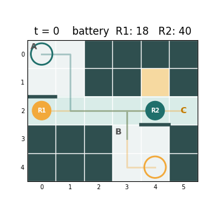

# Battery-aware Multi-Robot Path Planning

วางแผนเส้นทางให้หุ่นยนต์หลายตัวใช้ทางเดินร่วมกันโดยไม่ชนกัน ภายใต้แบตเตอรี่และช่องชาร์จที่มีจำกัด
โปรเจควิชา 271401 Artificial Intelligence for Robotics ทดสอบบน simulation แล้วรันจริงบน TurtleBot3 Burger 2 ตัว (ROS 2 Humble)



จุดเน้นของโปรเจคนี้มี 2 ข้อ เทียบกับ baseline ที่ใช้กฎตายตัว (แบตต่ำกว่าเกณฑ์ให้ไปชาร์จเต็ม)

1. **การชาร์จเป็น action ภายใน search** planner คิดล่วงหน้าทั้งลำดับงานว่าควรชาร์จตอนไหนและนานเท่าไร
2. **ช่องชาร์จเป็นทรัพยากรที่ต้องจอง** ช่องชาร์จอยู่ใน reservation table เหมือนช่องทางเดิน หุ่นจึงไม่แย่งกัน

## อัลกอริทึม

| ชั้น | วิธี | ไฟล์ |
|---|---|---|
| หุ่นหนึ่งตัวไปทางไหน ชาร์จเมื่อไร | Space-time A\* มี state `(cell, t, battery, k)` โดย `k` คืองานถัดไป | `core/st_astar.py` |
| ใครได้ก่อนเมื่อทางทับกัน | Prioritized Planning + reservation table | `core/prioritized.py`, `core/reservation.py` |
| ตอนรันจริงใครขยับได้เมื่อไร | Action Dependency Graph คุมลำดับการผ่านแต่ละช่อง ไม่ผูกนาฬิกา | `execution/adg.py`, `execution/executor.py` |

รายละเอียดทั้งหมดอยู่ใน [SPEC.md](SPEC.md)

## ติดตั้ง

ต้องใช้ Python 3.10 ขึ้นไป รันคำสั่งทั้งหมดจากโฟลเดอร์หลักของโปรเจค

```bash
git clone https://github.com/BESSTSU/AlgorithmProject.git
```

```bash
cd AlgorithmProject
```

```bash
pip install -r requirements.txt
```

ตรวจว่าใช้งานได้ เทสที่ต้องใช้ CoppeliaSim หรือ ROS จะถูกข้ามถ้าไม่ได้ใส่ `--coppelia` หรือ `--ros`

```bash
pytest -q
```

## ใช้งานโดยไม่ต้องมีหุ่น

เทียบวิธีหลักกับ baseline บนฉาก S0

```bash
python -m experiments.compare --scenario scenarios/s0.yaml
```

สร้างแอนิเมชันของแผน

```bash
python -m viz.animate --scenario scenarios/s0.yaml --method main --out outputs/plan.gif
```

เดโมรับงานต่อเนื่องบน `grid_sim` ปิดหน้าต่างหรือกด Ctrl+C เพื่อหยุด

```bash
python -m execution.lifelong --view
```

รันการทดลองหลักซ้ำ ได้ `results/results.csv` แล้ววาดกราฟ (ทับไฟล์เดิมใน `results/`)

```bash
python -m experiments.run_batch
```

```bash
python -m experiments.plots
```

ทดลองเพิ่มจำนวนหุ่นเป็น 2, 3 และ 5 ตัว

```bash
python -m experiments.run_batch --scaling
```

```bash
python -m experiments.plots --scaling
```

## ปรับเปลี่ยนสำหรับงานของคุณ

- **ค่าตัวเลข** แบต ความเร็ว ขนาดช่อง และค่าการทดลองทั้งหมดอยู่ใน `config.yaml`
- **แมพใหม่** เพิ่มไฟล์ข้อความใน `maps/` ไม่ต้องแก้โค้ด สัญลักษณ์คือ `#` กำแพง, `.` ทางเดิน, `A`/`B` ห้อง, `D` ประตู, `C` ช่องชาร์จ
  และเขียนกำแพงบางในบรรทัด `walls:` ได้ ดูตัวอย่างที่ `maps/arena_6x5.txt`
- **ฉากใหม่** เพิ่มไฟล์ใน `scenarios/` ระบุแมพ จุดเริ่ม แบตเริ่ม และลำดับงานของหุ่นแต่ละตัว ดูตัวอย่างที่ `scenarios/s0.yaml`
- **หุ่นหรือ simulator ใหม่** เขียน backend ตาม `RobotInterface` ใน `robots/base.py` โดย `core/` ไม่ต้องแก้ เพราะไม่ขึ้นกับ simulator หรือ ROS

## รันบน CoppeliaSim

ทดสอบกับ CoppeliaSim 4.10.0 Edu เปิดโปรแกรมไว้ก่อน (ZMQ Remote API พอร์ต 23000) แล้วติดตั้ง client ในหมายเหตุของ `requirements.txt`

```bash
python -m robots.coppelia --scenario scenarios/s0.yaml
```

## รันบนหุ่นจริง

ต้องมี TurtleBot3 Burger 2 ตัว, ROS 2 Humble และ AMCL กับ map server บนหุ่น สนามจริงต้องตรงกับแมพและขนาดช่องใน `config.yaml`
ทำตามคู่มือตามลำดับ: [เตรียมเครื่องและหุ่น](docs/setup_before_mapping.md), [ต่อหุ่นสองตัว](docs/m8b_guide.md),
[แมพและการระบุตำแหน่ง](docs/m8c_guide.md), [เดโมต่อเนื่อง](docs/demo_guide.md)

คำสั่งหลัก เปิดระบบบนหุ่นทีละตัว (เปลี่ยน `user@host` เป็นของหุ่น และ `tb3_0` เป็น `tb3_1` สำหรับตัวที่สอง)

```bash
python -m robots.robot_up user@host tb3_0
```

เช็คตำแหน่งโดยไม่ขยับหุ่น ต้องเช็คด้วยว่า scan ทับแมพ เพราะคำสั่งนี้อาจบอก OK ทั้งที่วางหุ่นผิดทิศหรือผิดช่อง

```bash
python3 -m robots.turtlebot_ros2 --scenario scenarios/s0.yaml --localize
```

รันแผน S0

```bash
python3 -m robots.turtlebot_ros2 --scenario scenarios/s0.yaml
```

รันเดโมต่อเนื่อง

```bash
python3 -m robots.turtlebot_ros2 --scenario scenarios/demo_ab.yaml --lifelong --view
```

ซ้อมโดยไม่มีหุ่นได้ด้วย `robots/fake_turtlebot.py`

## ผลการทดลองโดยสรุป

จำนวนฉากที่แก้ได้จาก 50 ฉาก บนแมพสนาม 6×5 หุ่น 2 ตัว `reserve` = 0 (ทุกวิธีใช้ชุดฉากเดียวกัน seed คงที่)

| วิธี | fixed | battery_urgency | random_restart |
|---|---|---|---|
| **วิธีหลัก** | **38** | **37** | **43** |
| กฎ 30% | 20 | 19 | 23 |
| กฎ 50% | 29 | 27 | 33 |
| กฎ 70% | 29 | 31 | 38 |
| กฎ 100% | 21 | 22 | 27 |

ไม่มีการชนในทุกการรัน รวมถึงรอบที่ใส่ความล่าช้าแบบสุ่ม CSV และกราฟทั้งหมดอยู่ใน `results/`

บนหุ่นจริงสองตัว ฉาก S0 ทำสำเร็จ: R1 ใช้ 64.0 วินาที (แผน 52) R2 ใช้ 52.3 วินาที (แผน 40) ศูนย์กลางหุ่นเข้าใกล้กันสุด 0.416 m

## ข้อจำกัด

- **หุ่นมองไม่เห็นคนหรือสิ่งกีดขวางที่ไม่อยู่ในแมพ** LiDAR ใช้ระบุตำแหน่งเท่านั้น ไม่มีการหลบหรือหยุดให้ ห้ามเข้าไปในพื้นที่ขณะหุ่นวิ่ง
- แบตเป็นแบตจำลองใน Python ทั้งใน simulation และบนหุ่นจริง ไม่ได้วัดจาก LiPo จริง การชาร์จคือการจอดบนช่องที่กำหนด
- Prioritized Planning ไม่ complete อาจหาทางไม่ได้แม้มีคำตอบอยู่จริง และไม่รับประกันคำตอบที่ดีที่สุดของทั้งทีม
- ยังไม่เคยรันเดโมบนหุ่นจริงสองตัวต่อเนื่องนานเกินราว 4 นาที

## โครงสร้าง

```
core/         อัลกอริทึม: แมพ แบต A* การจอง prioritized baseline ฉาก (ไม่ขึ้นกับ simulator หรือ ROS)
execution/    ADG, executor, โหมดรับงานต่อเนื่อง
robots/       grid_sim, CoppeliaSim, TurtleBot ROS 2, watchdog บนหุ่น
ros2/         แพ็กเกจ ROS 2 สำหรับ map server และ AMCL
experiments/  รันการทดลอง ตัววัด กราฟ
viz/          แอนิเมชันและจอแสดงผลสด
maps/         แมพกริด และแมพ nav2 ใน maps/ros/
scenarios/    ไฟล์ฉาก
results/      CSV และกราฟของการทดลอง
outputs/      แอนิเมชัน
tests/        เทส
docs/         คู่มือขึ้นหุ่นจริง
config.yaml   ค่าตัวเลขทั้งหมด
SPEC.md       สเปกเต็มของระบบ
```
