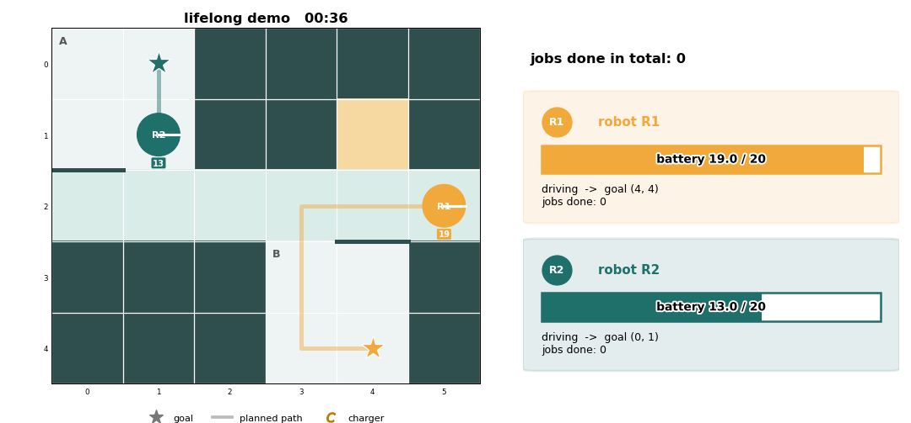

# คู่มือโหมดรับงานต่อเนื่อง (lifelong demo)

หุ่นได้งานใหม่ทันทีที่ถึงเป้าหมาย สลับห้อง A ↔ B วนไปเรื่อยๆ จนกด Ctrl+C
planner จะแทรกการแวะชาร์จเองเมื่อแบตสมมุติไม่พอ รายละเอียดการออกแบบอยู่ใน SPEC หัวข้อ 6.1

| หุ่น | ช่องเริ่มต้น | วนไปที่ |
|---|---|---|
| R1 (`tb3_0`) | (2,0) | (4,4) → (0,0) → (4,4) → … |
| R2 (`tb3_1`) | (2,4) | (0,1) → (4,3) → (0,1) → … |

แบตสมมุติเต็ม 20 ช่อง เดินช่องละ 1 ยืนรอไม่เสียแบต ชาร์จได้ 8 ต่อก้าว (`lifelong.battery` ใน `config.yaml`)
หุ่นที่แวะชาร์จจะชาร์จจนเต็มก่อนไปต่อ (`lifelong.fill_up`) จึงทำงานได้หลายงานต่อการชาร์จหนึ่งครั้ง
R1 เริ่มที่ 6 จึงต้องไปชาร์จก่อน ส่วน R2 เริ่มเต็ม

## ซ้อมบนโน้ตบุ๊ก (ไม่ต้องมีหุ่น)

ในโฟลเดอร์โปรเจค:

```bash
python -m execution.lifelong --view
```

หน้าต่างจะแสดงหุ่นวิ่งบน grid_sim ทีละช่อง ปิดหน้าต่างหรือกด Ctrl+C เพื่อหยุด
ใส่ `--jobs 20` ถ้าต้องการให้หยุดเองหลังทำครบ 20 งาน

## รันบนหุ่นจริง

1. เปิดระบบบนหุ่นทั้งสองตัวจากโน้ตบุ๊ก (PowerShell ในโฟลเดอร์โปรเจค) เปลี่ยน IP ให้ตรงกับวันนั้น

   ```bash
   python -m robots.robot_up turtlebest1@10.106.173.215 tb3_0
   ```

   ```bash
   python -m robots.robot_up turtlebest2@10.106.173.39 tb3_1
   ```

   คำสั่งนี้เปิด bringup, **watchdog** และ **AMCL ของหุ่นตัวนั้น** บนหุ่น ทุกโปรแกรมรันแยกจาก SSH
   (ตั้งแต่ 2026-10-15 ไม่ต้องเปิด localization บนโน้ตบุ๊กแล้ว และห้ามเปิดพร้อมกัน)
   ก่อนเริ่มควร ping หุ่นทั้งสองตัวให้ตอบครบและเร็ว และชาร์จแบตให้เต็ม แบตอ่อนทำให้ Wi-Fi ของหุ่นแย่ลง
   watchdog จะสั่งหุ่นหยุดเองถ้าไม่ได้รับคำสั่งจากโน้ตบุ๊กเกิน 0.5 วินาที เช่น Wi-Fi หลุด
   (ทดสอบกับหุ่นจริงแล้ว หยุดภายในประมาณ 0.8 วินาที) ปิดด้วย `--down` และดู log ด้วย `--status`

   (วิธีเดิมที่เปิด AMCL บนโน้ตบุ๊กตาม [m8c_guide.md](m8c_guide.md) ส่วน D ข้อ 3 ใช้ไม่ได้ดีบน hotspot ที่ช้า)
2. วางหุ่นกลางช่องเริ่มต้นในตารางข้างบน **ทั้งสองตัวหันไปทางช่องชาร์จ** (ด้านที่ไม่มีลูกล้อเล็กอยู่ข้างหน้า)
3. ตรวจก่อนออกตัว (หุ่นไม่ขยับ):

   ```bash
   python3 -m robots.turtlebot_ros2 --scenario scenarios/demo_ab.yaml --localize
   ```

   ต้องขึ้น `OK` ทั้งสองตัว และควรดูด้วยว่า scan ทับกำแพงในแมพ (RViz หรือให้ Claude เช็คให้)
   เพราะถ้าวางหุ่นกลับด้าน `--localize` ก็ยังขึ้น OK ได้
4. รัน (**หุ่นจะเคลื่อนที่**):

   ```bash
   python3 -m robots.turtlebot_ros2 --scenario scenarios/demo_ab.yaml --lifelong --view
   ```

   **หยุด:** กด **Ctrl+C** ในเทอร์มินัล หรือ**ปิดหน้าต่างแสดงผล** หุ่นทั้งสองตัวจะหยุดภายใน 0.05 วินาที
   และโปรแกรมจะสรุปจำนวนงาน แบต และระยะที่หุ่นเข้าใกล้กันที่สุด

## หน้าจอแสดงผล



หุ่นแต่ละตัวมีสีของตัวเองทุกที่: วงกลมบนแผนที่ ดาวเป้าหมาย เส้นทาง และการ์ดด้านขวา
- ซ้าย: สนาม หุ่นเป็นวงกลมสีพร้อมเส้นขาวบอกทิศที่หัน ป้ายตัวเลขใต้หุ่นคือแบตที่เหลือ
  ดาวสีเดียวกันคือเป้าหมาย เส้นจางคือเส้นทางที่เหลือ
- ขวา: การ์ดของหุ่นแต่ละตัว มีแถบแบตสีของหุ่น (เปลี่ยนเป็นแดงและขึ้น `LOW` เมื่อเหลือไม่ถึง 25%) สถานะ และจำนวนงาน
  สถานะ: `driving` เดิน, `waiting for the other robot` รออีกตัวผ่าน, `CHARGING` ชาร์จ, `planning` รอวางแผน
  ถ้ามีบรรทัด `will stop at the charger first` แปลว่างานนี้ planner ให้แวะชาร์จก่อน

## ความปลอดภัย

- แผนทุกครั้งถูกตรวจซ้ำว่าไม่มีสองตัวอยู่ช่องเดียวกันหรือเดินตามเข้าช่องที่อีกตัวเพิ่งออก ถ้าผิด ไม่ใช้แผนและหยุด
- ถ้าจุดกลางหุ่นสองตัวเข้าใกล้กันน้อยกว่า 0.30 m (`ros2.safety_distance`) โปรแกรมหยุดหุ่นทุกตัวและจบทันที
  ข้อความจะขึ้นว่า `safety stop: R1 and R2 are ... m apart`
- ถ้าตำแหน่งจาก AMCL ของตัวไหนหายเกิน 1 วินาที ตัวนั้นหยุดรอจนตำแหน่งกลับมา
- ถ้า Wi-Fi หลุดหรือโปรแกรมบนโน้ตบุ๊กค้าง watchdog บนหุ่นสั่งหยุดเองหลังไม่มีคำสั่ง 0.5 วินาที
  (`turtlebot3_node` เองไม่มีระบบนี้ ถ้าไม่มี watchdog หุ่นจะวิ่งต่อด้วยคำสั่งสุดท้าย)
- เมื่อเลิกใช้: `python -m robots.robot_up <user@IP> <namespace> --down` ทั้งสองตัว แล้ว `sudo shutdown now` บนหุ่น
- ให้มีคนอยู่ใกล้สนามตลอด พร้อมกด Ctrl+C หรือยกหุ่น
